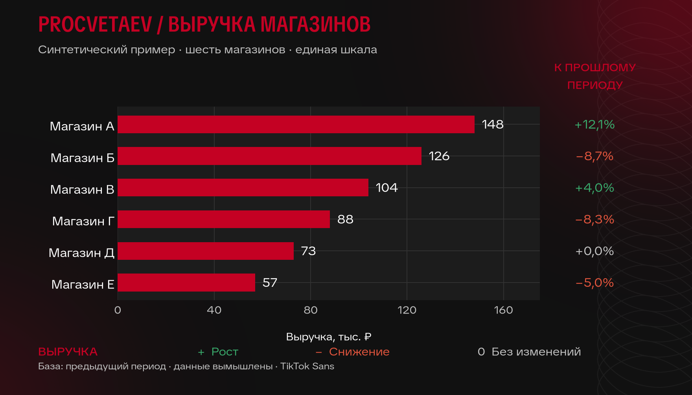

# Better Charts Skill

Data visualization guidelines and styles for AI agents.

## Install in Hermes

```bash
hermes skills install tim-toothed/better-charts-skill/skills/analytical-visualization --category data-science --yes
```

The repository is named **better-charts-skill**; the installable skill retains the name **analytical-visualization** and description `Create data visualization.` No credentials or service configuration are needed.

Optional discovery:

```bash
hermes skills tap add tim-toothed/better-charts-skill
hermes skills search visualization --source github
```

## What it does

- Chooses charts, tables or text to match the question, not a fixed dashboard template.
- Keeps units, comparison bases, missing values, uncertainty and qualifiers visible.
- Separates positive/negative direction from good/bad judgments.
- Provides nine deterministic Matplotlib presets and immutable semantic color tokens.
- Requires inspection of the actual exported image, not just a successful render.

It presents already verified results. It is not a data collector, calculation engine or substitute for domain validation. Other agents can read `skills/analytical-visualization/SKILL.md` and use the accompanying scripts; Hermes-specific delivery/tool names need adaptation to their own runtime.

## Style gallery


Available: `neutral-light`, `minimal`, `dark`, `high-contrast`, `monochrome`, `muted`, `procvetaev`, `business-blue`, `warm`.

The distributed preference is **not selected**. `neutral-light` is a neutral temporary fallback until the user chooses a style. All previews use invented data and generic labels. The procvetaev template includes its authorized motif, #C40123 localized gradient, and TikTok Sans OFL fonts. The other eight presets use Matplotlib's DejaVu Sans. No private reports or deployment configuration are bundled.



## Run examples

From a clone, with [uv](https://docs.astral.sh/uv/):

```bash
uv run --no-project --with matplotlib python skills/analytical-visualization/scripts/example.py --output example.png
uv run --no-project --with matplotlib --with pillow python skills/analytical-visualization/scripts/style_gallery.py --output gallery
uv run --no-project --with matplotlib python skills/analytical-visualization/scripts/procvetaev_example.py --output procvetaev-example.png
```

Alternatively install `matplotlib` and `pillow` in your own virtual environment. No system-wide installation is required. Scripts use the headless `Agg` backend. Import `apply_style`, `style_context`, and `delta_color` from the bundled `chart_styles.py` before creating figures; see SKILL.md for the API example. Presets reset rcParams; `style_context` restores the previous settings.

## Layout

```text
README.md
LICENSE
docs/gallery.png
skills/analytical-visualization/
  SKILL.md
  references/chart-guidelines.md
  scripts/chart_styles.py
  scripts/style_gallery.py
  scripts/example.py
  scripts/procvetaev_example.py
  references/asset-provenance.md
  assets/  # stylesheet, authorized motif and OFL fonts
```

## License

MIT. Author: [tim-toothed](https://github.com/tim-toothed). The public bundle is a portable edition of the 0.4.0 skill, without private operational notes or deployment configuration. Third-party stylesheet attribution and the separate OFL font license are documented in [asset provenance](skills/analytical-visualization/references/asset-provenance.md). The supplied template motif is publicly distributed with the publisher's explicit authorization.
