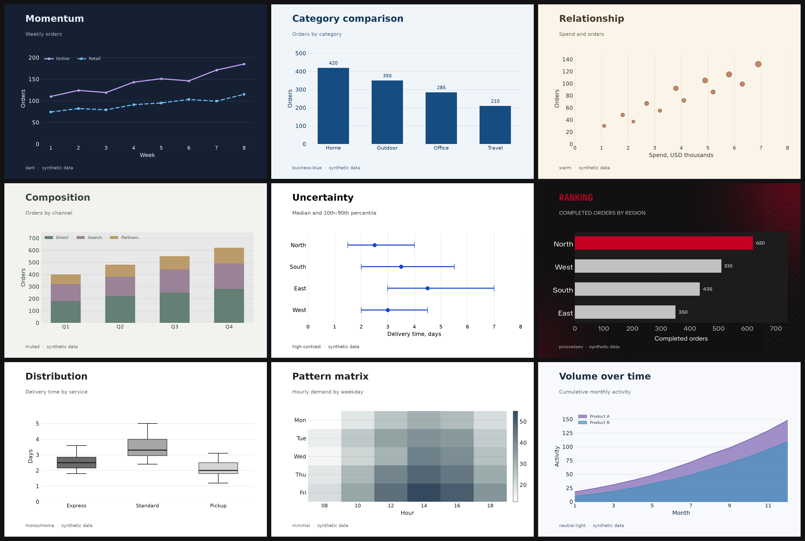

# Analytics Visual Skill


Agent skill for designing data visualization with clear visual narrative.

Guides agents through choosing charts, arranging layouts, and connecting findings into visual reports. Exports PNG images for sharing in Telegram and other messengers.

## Install

```bash
hermes skills install tim-toothed/analytics-visual-skill/skills/analytics-visual --category data-science --yes
```

Then ask your agent to use **Analytics Visual Skill** when preparing a report or visualization.

## Highlights

- **Visual storytelling.** Organize findings into a visual narrative the reader can follow.
- **Chart selection.** Choose charts for trends, comparisons, distributions, relationships, and composition.
- **Layout.** Arrange charts and annotations into dashboards and visual reports.
- **Nine styles.** Matplotlib presets with light, dark, muted, and high-contrast options.
- **PNG output.** Share visualizations directly in Telegram, other messengers, or documents.

## Examples

Nine chart types in nine styles. All examples use synthetic data.



Available styles: `neutral-light`, `minimal`, `dark`, `high-contrast`, `monochrome`, `muted`, `procvetaev`, `business-blue`, and `warm`.

Choose a style with your agent. Until you choose one, the skill uses `neutral-light`.

## How it works

The skill provides visualization guidelines and Python styling helpers. The agent writes and runs Matplotlib code for your task, then inspects the exported PNG before delivering it.

Requires Python and Matplotlib. The skill includes instructions for running with `uv` when Matplotlib is not installed.

Other agents can use the [skill instructions](skills/analytics-visual/SKILL.md) and bundled scripts, adapting tool calls to their own environment.

## License

[MIT](LICENSE). Third-party asset and font terms are listed in [asset provenance](skills/analytics-visual/references/asset-provenance.md).
